# CSAPP Bomb Lab 实验报告

## 1. 实验目标与方法

本实验要求分析个人 x86-64 Linux bomb 的六个正式关卡和 Honor，并在 `defuser.c` 中实现对任意 challenge（Honor 还包括 context）有效的求解函数。

实验环境为 Ubuntu on WSL（Linux x86-64），使用 GCC、GNU Make、`objdump`、GDB 和课程提供的公开测试脚本。我的分析步骤是：先从关卡入口确认输入个数和比较对象；再沿着 `call`、跳转表或指针访问追踪计算；遇到动态数据时用 GDB 检查；最后把 32 位寄存器运算整理为 `uint32_t` 公式，并用多个 seed 验证。凡是结果写入 `eax` 等 32 位寄存器的运算，都按模 2^32 理解。

## 2. 六个正式关卡

### Phase 1：追踪函数调用

入口中 `mov $1,%esi`、`cmp $1,%eax` 表明输入解析一个整数；`call p1_compute` 后，`cmp %eax,-0x14(%rbp)` 表明该整数必须等于计算函数的返回值,因此需要继续分析 `p1_compute` 及其三个 helper。

`p1_compute` 把 challenge 拆成高 32 位 `hi`、右移 16 位后的低 32 位 `mid` 和低 32 位 `lo`。逐个还原 helper：`p1_step0` 对 `hi` 异或常量并加上 `4*lo`；`p1_step1` 计算 `5*hi+mid` 再异或常量；`p1_step2` 计算 `lo+常量` 再与上一步异或。入口最终把 `step2` 与先前保存的 `step0` 异或。

```text
step0 = (hi ^ 0xb1dd) + 4*lo
step1 = (5*hi + mid) ^ 0xd395
step2 = (lo + 0x6492) ^ step1
answer = step2 ^ step0
```
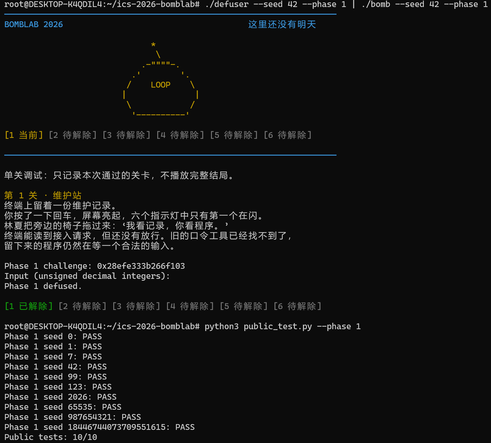

### Phase 2：从循环寄存器恢复递推

入口传给 `valid_u32_fields` 的数量是 6，`sscanf` 的返回值也必须为 6。首元素的汇编依次右移 37 位、保留 7 位、乘 3（`lea (%rax,%rax,2)`），得到 `x[0]`。

循环以 `edx=1` 和 `ecx=11` 起步；每轮下标加 1、位移量加 3。循环先将前一输入乘 3 并减当前下标，再取 challenge 对应位置的 4 位、加 11，最后异或两项并与当前输入比较。因此：

```text
x[0] = 3 * ((challenge >> 37) & 0x7f)
x[k] = (3*x[k-1] - k) ^ (((challenge >> (8 + 3*k)) & 0xf) + 11), k=1..5
```

这个寄存器追踪说明后五项依赖前一项，不是六个互不相关的常数。
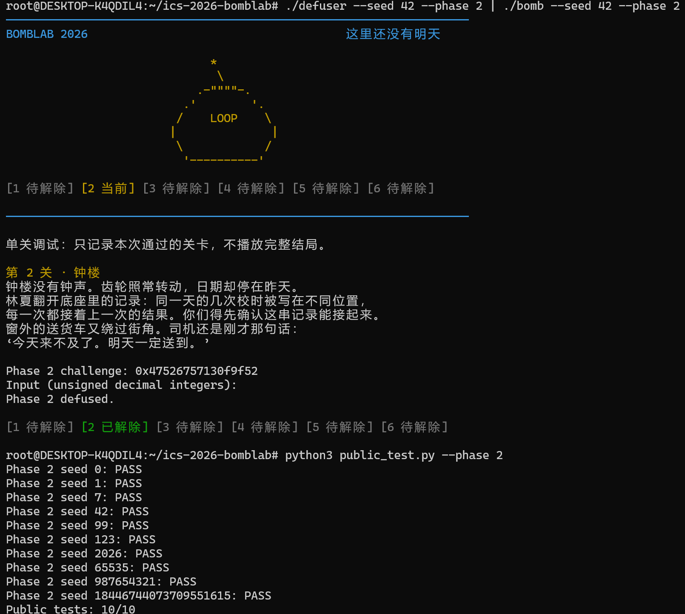

### Phase 3：恢复跳转表的编号映射

入口解析两个整数：`and $7,%edi` 后第一个输入必须等于 `challenge & 7`；第二个输入与 `p3_dispatch` 返回值比较。调用前另一个参数为 `v = low32(challenge >> 32) ^ low32(challenge >> 3)`。

`p3_dispatch` 的间接跳转使用编号索引表。仅按函数地址或 `case` 名称顺序推断会错；我用 GDB 查看 `0x405820` 的 8 个表项，并把表项地址对应到跳板，再对应到实际 case。由此得到：`0→case3, 1→case1, 2→case0, 3→case2, 4→case6, 5→case5, 6→case4, 7→case7`。各分支的返回关系为：

| selector | 第二个输入 |
|---:|---|
| 0 | `(v ^ 0xa92a) + (v >> 1)` |
| 1 | `5*v + 0x2e644` |
| 2 | `5*v + 0x2556` |
| 3 | `(4*v) ^ 0xd000` |
| 4 | `5*v + 0x923f` |
| 5 | `(v ^ 0x3aa6) + (v >> 1)` |
| 6 | `(4*v) ^ 0x9e8e` |
| 7 | `5*v + 0x2b16a` |

`case2` 的指令是 `xor $0xd0,%ah`；尤注意`ah` 是 `eax` 的第 8–15 位，因此整体等价于与 `0xd000` 异或。

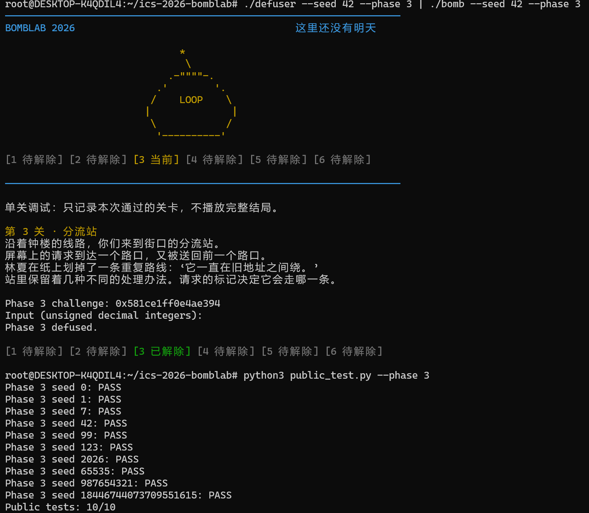
### Phase 4：按递归分支还原返回值

入口把 `challenge & 0x7f` 作为 target，范围初始为 `[0,127]`，并计算 salt：

```text
target = challenge & 0x7f
salt = low32(challenge >> 7) ^ low32(challenge >> 32)
```

`p4_walk` 用 `low + ((high-low)>>1)` 求中点。然后将目标与中点比较；相等时走基例，返回 `(mid+0xeb)^salt`；小于中点时递归到 `[low,mid-1]`，大于中点时递归到 `[mid+1,high]`。两条递归返回路径都把子结果乘 3，并与 `mid+salt` 组合，最后分别异或 `0x0d` 或 `0x13`。因此实现时保留了二分递归的区间更新和两条不同的返回组合，而不是只计算最终某次运行的值。

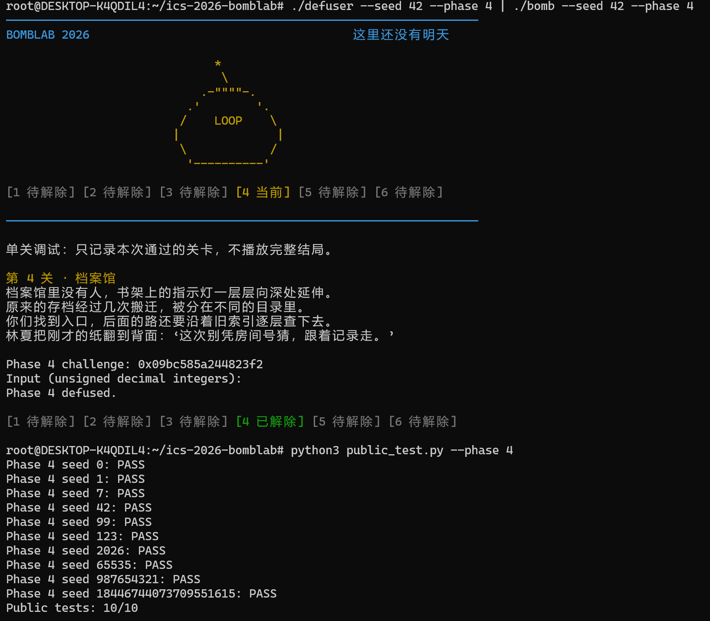
### Phase 5：从结构体偏移与链表访问恢复遍历

入口解析两个整数：第一个与 `p5_traverse` 的返回值比较，第二个与函数写入输出指针的值比较。反汇编中 `mov 0x8(%rdx),%esi` 和 `add 0xc(%rdx),%eax` 表明节点偏移 8、12 处各有一个 32 位字段；`mov (%rdx),%rdx` 则沿偏移 0 的 next 指针前进。

GDB 检查 head 表后，入口下标为 `challenge & 7`，对应头节点如下：

```text
0→0x405bf0  1→0x405c30  2→0x405c20  3→0x405ba0
4→0x405bc0  5→0x405bb0  6→0x405c10  7→0x405c00
```

节点数据（均为十六进制）：

| 节点 | next | field8 | field12 |
|---|---|---:|---:|
| 0x405ba0 | 0x405bc0 | 0x0b85 | 0xcd26 |
| 0x405bb0 | 0x405c10 | 0x072c | 0x2e17 |
| 0x405bc0 | 0x405bb0 | 0x0933 | 0x388d |
| 0x405bd0 | 0x405c50 | 0x042c | 0x1e32 |
| 0x405be0 | NULL | 0x0155 | 0xd238 |
| 0x405bf0 | 0x405c30 | 0x0333 | 0xd25f |
| 0x405c00 | 0x405c40 | 0x0883 | 0x085d |
| 0x405c10 | 0x405c00 | 0x0685 | 0xf503 |
| 0x405c20 | 0x405ba0 | 0x000d | 0x5209 |
| 0x405c30 | 0x405c20 | 0x027d | 0x782a |
| 0x405c40 | 0x405bd0 | 0x050f | 0x7f39 |
| 0x405c50 | 0x405be0 | 0x0a80 | 0x6fbd |

`steps=(challenge>>3)&3` 表示从 head 起沿 next 前进的次数，所以总处理 `steps+1` 个节点。初值为 `low32(challenge>>6) ^ low32(challenge>>32) ^ 0x2f02`。每个节点执行 `acc=(acc+field12)*5`，再 `acc ^= field8`。最终第一个输入是 `acc`，第二个输入是最后节点的 `field8`。第二个输入不是“链表长度”，也不是节点地址；它是最后一次访问中从节点偏移 8 读取的字段值。若不检查 GDB 中的节点内容，只看控制流就无法恢复这些随地址存放的常量。

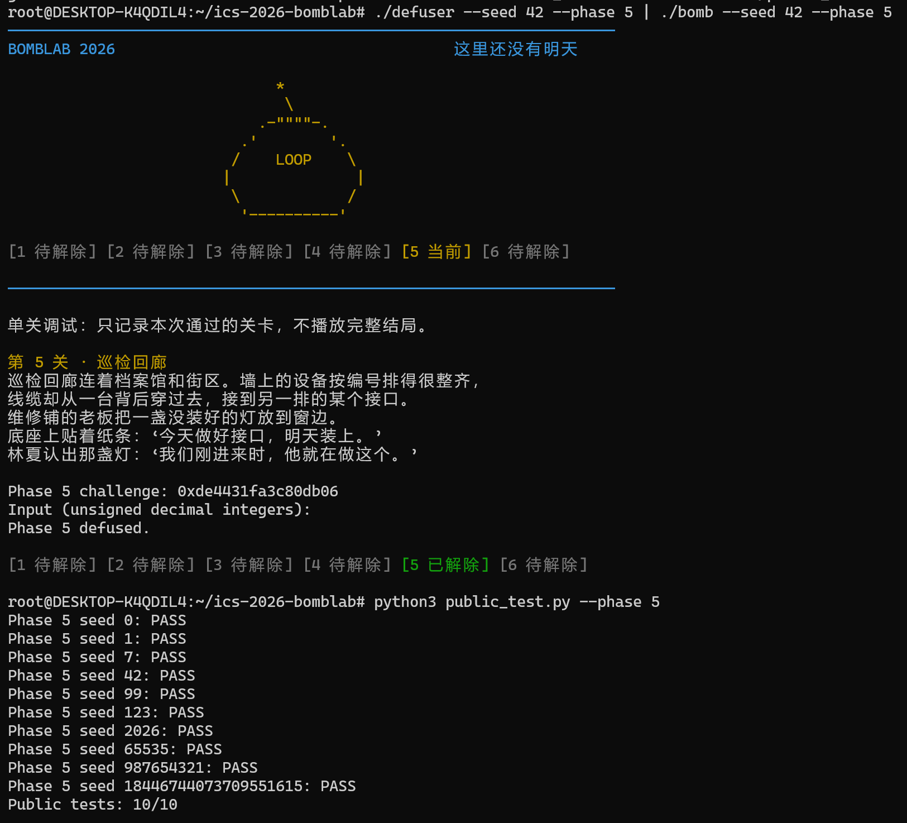
### Phase 6：拆解两次间接函数调用

`p6_dispatch` 先用 `challenge & 7` 索引函数表，输入参数为 `low32(challenge>>6) ^ low32(challenge>>32)`；第一次结果异或 `0xd7b4` 后，再用 `(challenge>>3)&7` 索引同一张表；第二次结果最后加 `0x100e`。

GDB 读取表项后，编号 0–7 对应函数为 `op5, op2, op0, op4, op1, op0, op5, op3`。函数本身分别实现：

```text
op0(x) = ror32(x,5)
op1(x) = (8*x + 0x7e68) ^ (7*x)
op2(x) = (x ^ (x >> 2)) + 0x4429
op3(x) = (x + 0x2f0a) ^ (x >> 5)
op4(x) = (x ^ 0x4410) + (x << 5)
op5(x) = rol32(x,3) ^ 0x61a6
```

因此实现重点是按表项而非函数名称顺序选函数，并保留两次调用间的异或常量。

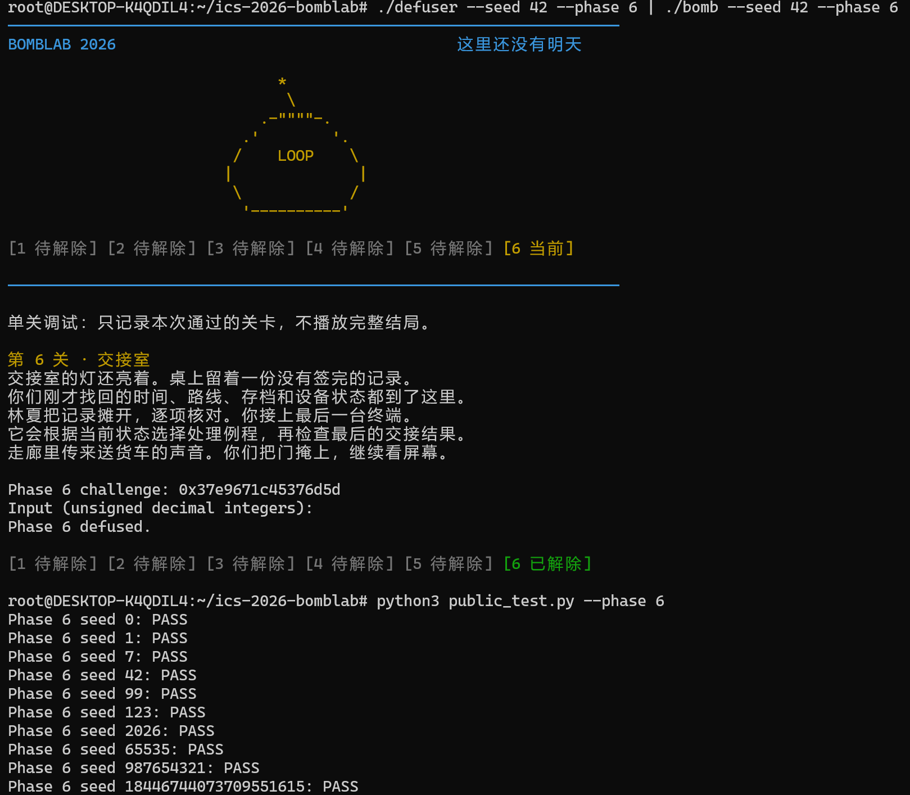
## 3. Honor

`secret_copy` 是逐字节复制。`secret_gate` 检查长度在 36–163 字节，内存采用小端序，检查偏移 32 处为 ASCII `OPEN`；随后 `secret_phase` 从偏移 36 开始解析三个整数。因此输出前缀采用 32 个 `A` 加 `OPEN`。

在 `secret_phase` 中，第一个字段是 `c=context&3`。令：

```text
A = low32(challenge >> 32) ^ low32(challenge)
B = low32(context >> 32) ^ low32(context)
T = low32(context >> 16)
u = A ^ B
m = (rol32(u,1) + 0x197) ^ 0x643f
```

`secret_mix` 对 `u` 循环左移 1 位、加 `0x197`、再异或 `0x643f`。结合 `secret_phase` 后，第二、第三字段为：

```text
second = m ^ (T ^ (c * 0x197))
third = second ^ ((A >> 1) + B + c + 0x643f)
```
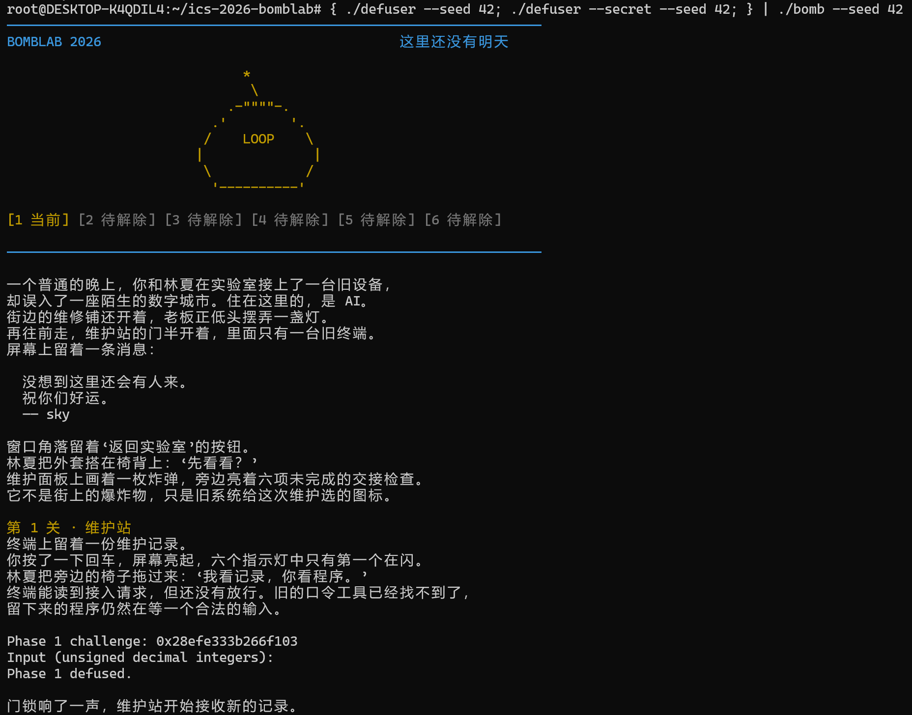
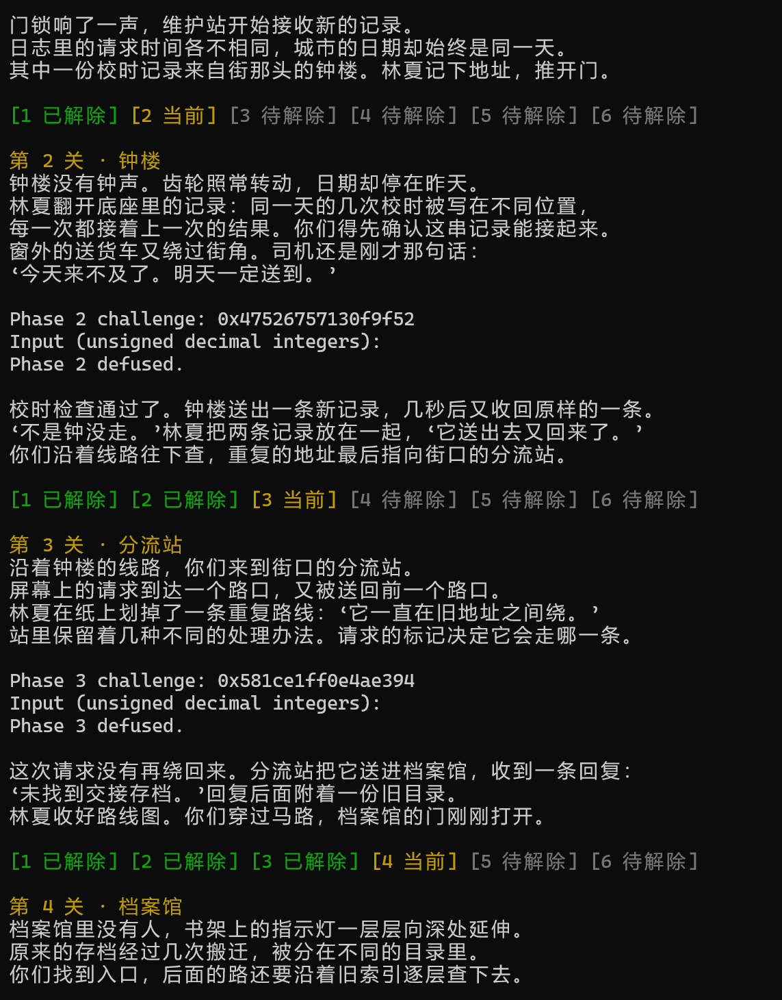
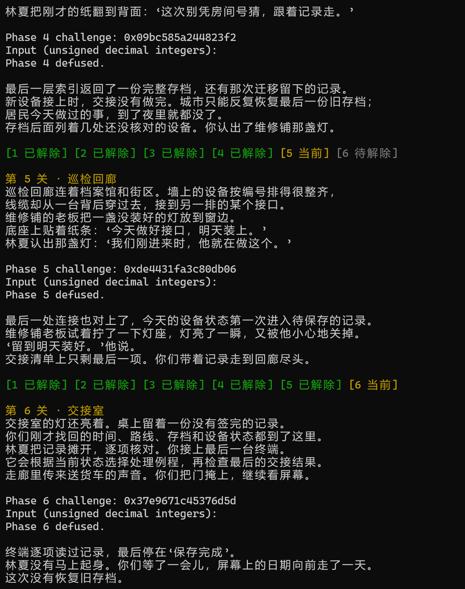
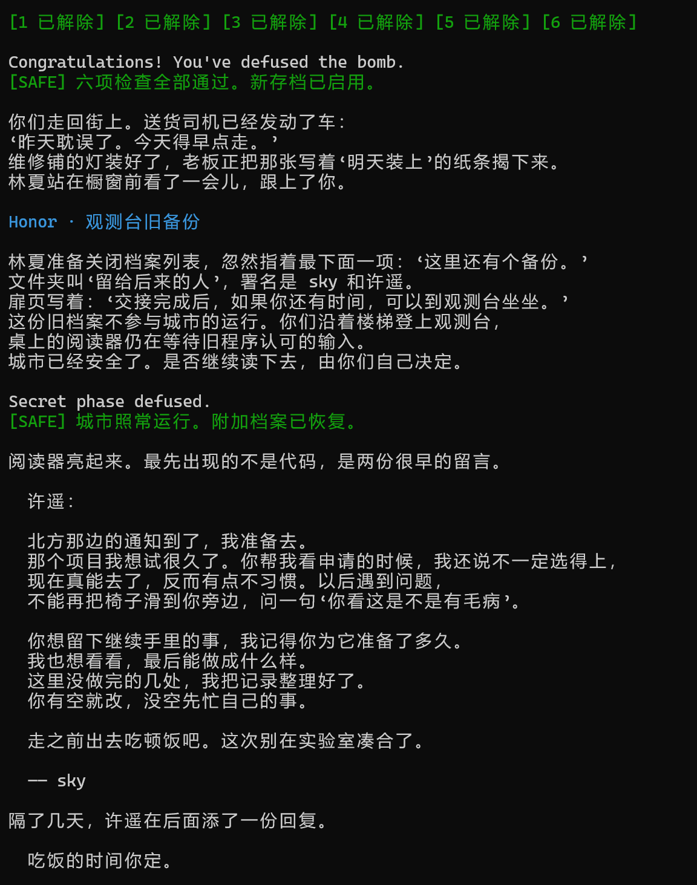
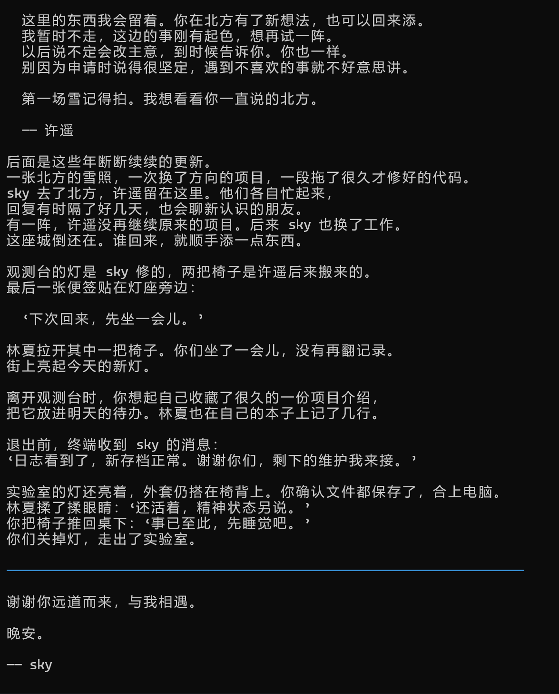

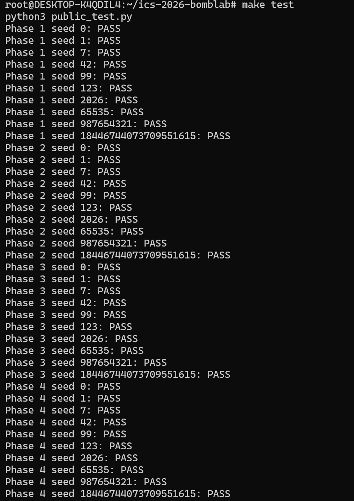
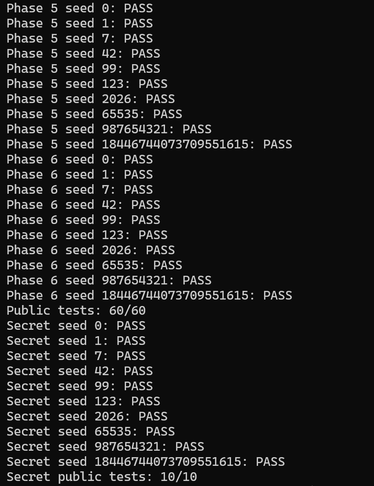
## 4. 验证记录

- `make` 编译成功。
- `make test`：六关公开测试 **60/60**；Honor 公开测试 **10/10**。
- 非公开 seed 43：运行 `{ ./defuser --seed 43; ./defuser --secret --seed 43; } | ./bomb --seed 43`，六个 Phase 均显示 `defused`，Honor 显示 `Secret phase defused.`。

